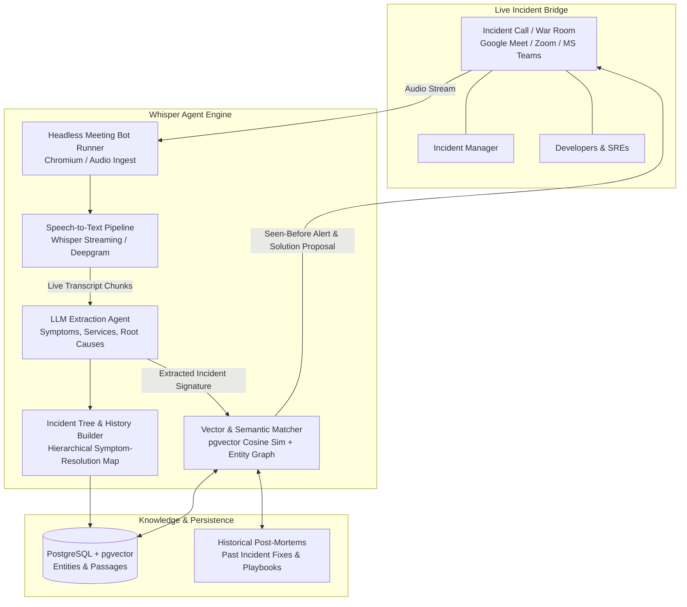
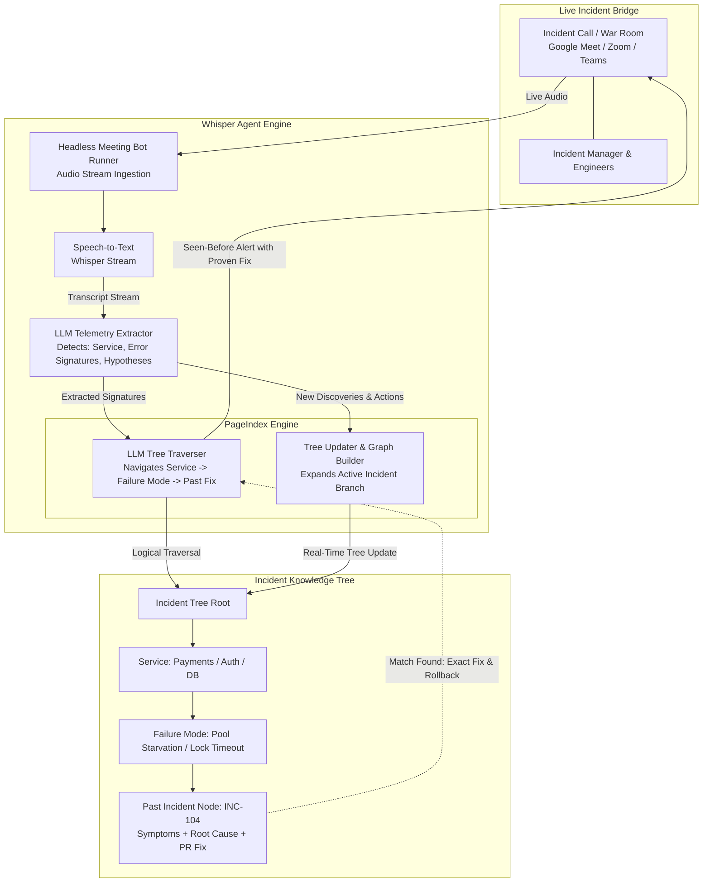

# Chat Session 001: Whisper Agent (WHISPER Agent) Project Inception

- **Date:** 2026-10-18
- **Session File:** `.ai/history/chat-001.md`
- **Topic:** Inception, architecture, and planning of **Whisper Agent**
- **Status:** Active / In Progress

---

## 1. Executive Summary & Vision

The user proposed creating **Whisper Agent** (`WHISPER Agent`), an intelligent incident management bot designed to operate as a silent listener on live incident bridges (war rooms, outage calls).

### Key Value Proposition
During high-pressure outage calls involving Incident Managers, developers, SREs, and triage/filter teams:
1. **Joins & Listens Silently:** Joins bridge calls (Meet, Zoom, Teams) in the background.
2. **Builds Incident Resolution Trees:** Continuously transcribes the call, tracks symptoms, systems mentioned, hypotheses, commands executed, and resolution steps to build/update an evolving incident tree.
3. **Proactive "Seen-Before" Guidance:** Automatically identifies when an active incident matches a historical outage, immediately notifying the team:
   - *"This incident has happened before (e.g., INC-204)."*
   - *"Previously, this was caused by [Root Cause] and resolved by [Resolution/Fix] by [Engineer/Team]."*
   - *"Recommended mitigation steps: [Steps]."*

---

## 2. Existing Workspace & Foundation

The workspace architecture provides a foundational starting point for Whisper Agent.

### What is Present in the Monorepo Architecture:
- **Monorepo Structure (pnpm workspace):**
  - `apps/api` - Fastify API gateway & services
  - `apps/web` - React / Vite dashboard console
  - `packages/db` - PostgreSQL + Drizzle ORM + `pgvector` for vector embeddings
  - `packages/core` - Roles, permissions, access lists, shared domain models
  - `packages/connectors` - Data ingestion & connector framework
- **Key Schema Assets:**
  - `entities`: Table supporting `incident`, `meeting`, `decision`, `principle` entity types.
  - `passages`: Chunked knowledge with 1024-dimension vector embeddings (`hnsw` cosine) + full-text search (`tsvector`).
  - `meetingRules`: Auto-join rules matching call title keywords (e.g. `titleContains: ["incident", "post-mortem"]`).
  - `conversations` & `messages`: Threaded chat history across surfaces (web, Slack, Discord, Teams).
- **Design Milestones:**
  - **Milestone 7:** Incidents & drafts (incident records, watcher heads-ups, automated write-ups).
  - **Milestone 8:** Meetings (headless meeting bot for Google Meet, Zoom, Teams; transcripts; summaries).
  - **Milestone 6:** The Brain (router, helpers, seen-before incident recall).

---

## 3. Whisper Agent Architectural Blueprint

---

## 4. Conversation Log & Chronology

### Turn 1 — 2026-10-18T22:12:15
- **User Action:** Sent voice recording proposing **Whisper Agent** (`WHISPER Agent`).
- **Concept:** Agent joins incident calls, listens in the background, updates history/decision tree, and chimes in when recurring incidents occur with how it was solved before.
- **Reference:** Pointed to the workspace monorepo as containing the basic implementation.

### Turn 2 — 2026-10-18T22:13:55
- **Assistant Response:**
  - Analyzed and confirmed the user's voice prompt.
  - Outlined the end-to-end incident bridge intelligence loop.
  - Cross-referenced with foundational capabilities (`entities`, `passages` vector search, `meetingRules`, headless bot design).
  - Asked key architectural questions:
    1. Where to host code (extend existing monorepo vs standalone repo).
    2. Primary call platform target (Google Meet, Zoom, Teams, or local simulation).
    3. Transcription & STT engine preference (Whisper, Deepgram, etc.).

### Turn 3 — 2026-10-18T22:36:47
- **User Instruction:** Maintain conversation history under `.ai/history/` by creating and continuously updating `chat-001.md`.
- **Assistant Action:** Created `chat-001.md` capturing all context, system requirements, architecture diagrams, and chronological notes.

### Turn 4 — 2026-10-19T10:05:17
- **User Proposal:** Use the **PageIndex technique** instead of traditional vector search for Whisper Agent.
- **Architectural Analysis:**
  - **PageIndex Concept:** A vectorless, tree-based RAG framework (pioneered by VectifyAI) that replaces mathematical vector similarity with **hierarchical tree indexing** (smart table-of-contents / failure taxonomy) and **LLM-driven tree search / reasoning navigation**.
  - **Why it fits Whisper Agent:**
    1. **Direct Alignment with the Incident Tree:** The user's core vision is that Whisper Agent *"updates its history, its tree"* while listening to live calls. PageIndex natively operates on a hierarchical tree structure rather than flat chunks.
    2. **Eliminates Chunk Fragmentation:** Vector RAG splits post-mortems into arbitrary 500-token chunks, separating symptoms, error logs, root causes, and resolutions. PageIndex preserves the structural relationship between symptoms $\rightarrow$ root cause $\rightarrow$ remediation.
    3. **Eliminates "Vibe Matching":** Outages often share generic error messages (*"500 Internal Error"*, *"Connection reset"*). Vector embeddings match on superficial textual similarity. PageIndex uses LLM reasoning to navigate the tree by Service $\rightarrow$ Subsystem $\rightarrow$ Failure Mode, ensuring exact causal matching.
    4. **Explainable Retrieval Paths:** Whisper Agent can cite the exact path traversed: e.g., `Payments Service -> Redis Cache -> Connection Pool Exhaustion -> INC-102`.
    5. **Zero Vector DB Overhead:** Avoids embedding generation latency, embedding drift, and complex vector indexing (`hnsw` / `pgvector` indexing tuning).

### Turn 5 — 2026-10-19T10:07:30
- **User Question:** *"Should we use both or PageIndex is best and that alone is sufficient?"*
- **Architectural Decision & Trade-off Analysis:**
  - **PageIndex Alone is Sufficient for V1:**
    - For initial build and hundreds of incidents, PageIndex alone is simpler, cleaner, and completely avoids vector database setup, embedding API costs, embedding model drifts, and chunk-tuning.
    - It directly fulfills the core requirement: reasoning through symptoms, navigating the hierarchy, and updating the tree in real time.
  - **Where PageIndex Has Blindspots at Scale:**
    1. *Exact Error Code Lookups:* If an engineer mentions a very specific obscure error string (e.g. `ORA-01555: snapshot too old`), keyword/vector search finds it in 5ms across 10,000 files. Pure tree navigation might need multiple reasoning hops to reach the right node.
    2. *Tree Depth / LLM Traversal Latency:* If an organization has thousands of incidents and 200 microservices, traversing the entire tree via multi-step LLM calls could add latency on live calls.
  - **Pragmatic Strategy (PageIndex-First, Hybrid-Ready):**
    - **V1 (Build Now):** Build with **PageIndex alone**. It is 100% sufficient to prove the bot, join calls, maintain the tree, and recall incidents via LLM reasoning.
    - **V2 (Scale):** Add a lightweight lexical/vector fast-path (e.g., using existing `pgvector`/`tsvector` in `passages`) only as an accelerator to instantly jump into the right branch of the PageIndex tree when specific error codes appear.

### Turn 6 — 2026-10-19T16:47:11
- **User Question:** *"Any product in market right now like this?"*
- **Market Landscape & Competitive Intelligence:**
  - **Current Market Players:**
    1. **Rootly (AI Meeting Bot):**
       - Joins Zoom, Meet, Teams, Webex, and Slack Huddles.
       - *Focus:* Passive AI Scribe. Transcribes speech, auto-updates the incident timeline in Slack, catches up late-joiners, and drafts postmortems.
       - *Limitation:* It does not actively reason through live verbal discussion to navigate a causal failure tree and proactively shout out historical solutions in real time.
    2. **incident.io (AI SRE & "Similar Incidents"):**
       - Strong at correlating alerts, PRs, and past incidents to surface *"Seen before"* recommendations.
       - *Limitation:* **Chat-First (Slack/Teams).** It does not deploy an active voice listener into live video/audio bridges. During critical P1 outages, engineers talk aloud on audio bridges rather than typing into Slack.
    3. **PagerDuty (Operations Cloud / Generative AI):**
       - Offers "Similar Incidents" widgets in the web console and Slack based on alert metadata and keywords.
       - *Limitation:* Static metadata matching, no audio bridge presence or live tree navigation.
    4. **Resolve.ai / BigPanda:**
       - Autonomous alert correlation and runbook execution engines.
       - *Limitation:* Ingests monitoring telemetry/APIs; completely detached from human verbal discussions on bridges.
    5. **Recall.ai / MeetStream.ai:**
       - Meeting bot infrastructure layer (headless browser bots joining calls to stream audio/video via WebSockets). Often used as the plumbing for tools like Rootly.
  - **Whisper Agent's Unique Market Differentiator (The Gap):**
    - The existing market is split between **Passive Audio Recorders** (transcribe & summarize post-call) and **Chat-Based Copilots** (require typing in Slack).
    - **Whisper Agent fills the missing sweet spot:** An **active, voice-first incident intelligence partner** that listens to spoken audio in real time, maintains a **hierarchical PageIndex tree**, and proactively intervenes during the call with verified solutions from past incidents.

---

## 5. Architectural Comparison: Vector RAG vs. PageIndex Tree vs. Hybrid

| Dimension | Vector RAG (`pgvector`) | PageIndex Alone (V1 Recommended) | Hybrid (PageIndex + Vector Fast-Path) |
|---|---|---|---|
| **Primary Retrieval** | Approximate Nearest Neighbor ($k$-NN) | Top-down LLM Tree Traversal & Reasoning | Vector/BM25 fast branch jump + Tree Reasoning |
| **Exact Error Code Search** | Fast | Requires traversing to correct node | Instant (direct hit) |
| **Architectural Causality** | ❌ None (flat chunks) | ✅ Complete (Service $\rightarrow$ Subsystem $\rightarrow$ Fix) | ✅ Complete |
| **Setup Complexity** | High (Embeddings, `pgvector`, HNSW) | **Lowest (JSON Tree + LLM Prompts)** | Medium-High |
| **Live Call Updates** | Costly re-indexing | **Instantaneous node appending** | Instant tree update + async embedding |
| **Explainability** | Opaque float score (e.g., `0.84`) | **Full explicit path trace** | Full explicit path trace |

---

## 6. Competitive Positioning Matrix

| Product | Joins Live Audio Bridge (Meet/Zoom/Teams) | Real-time Voice Listening | Proactive "Seen-Before" Fix Recommendation | Causal Incident Tree (PageIndex) | Primary Interface |
|---|:---:|:---:|:---:|:---:|:---:|
| **Rootly AI** | ✅ | ✅ (Transcription) | ❌ (Post-call / manual query) | ❌ (Linear timeline) | Video Call + Slack |
| **incident.io** | ❌ (Opens link only) | ❌ | ✅ (Based on alerts & PRs) | ❌ (Vector/Graph search) | Slack-first |
| **PagerDuty Copilot** | ❌ | ❌ | ✅ (Metadata/ticket matching) | ❌ (Alert clustering) | Web / Slack |
| **BigPanda / Resolve** | ❌ | ❌ | ✅ (Runbook triggers) | ❌ (Alert topology) | Web console |
| **Whisper Agent (Ours)** | ✅ | ✅ (Real-time stream) | ✅ (During active bridge) | ✅ (Hierarchical PageIndex) | Live Bridge + Web/Chat |

---

## 7. Updated Whisper Agent Blueprint (PageIndex-Powered)

---

## 8. Next Steps & Pending Decisions

1. [ ] **Define Incident Tree Schema (PageIndex format):** Standardize the JSON structure for the Incident Tree (`services`, `failure_modes`, `symptoms`, `diagnostic_steps`, `resolutions`).
2. [ ] **Clarify Project Placement:** Determine if Whisper Agent will be built inside `apps/whisper-agent` or as an independent repository/package.
3. [ ] **Select Bridge Adapter:** Select initial meeting connector (e.g. Google Meet headless bot via Puppeteer/Playwright, or local audio stream simulator).
4. [ ] **Continuous Updates:** Keep this log updated with each design decision and implementation phase.

